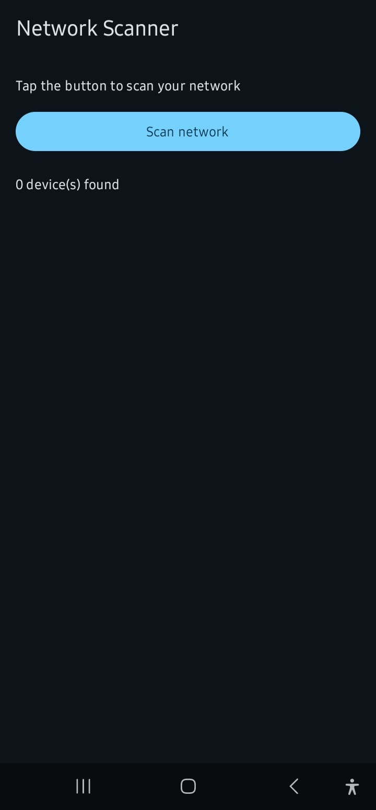
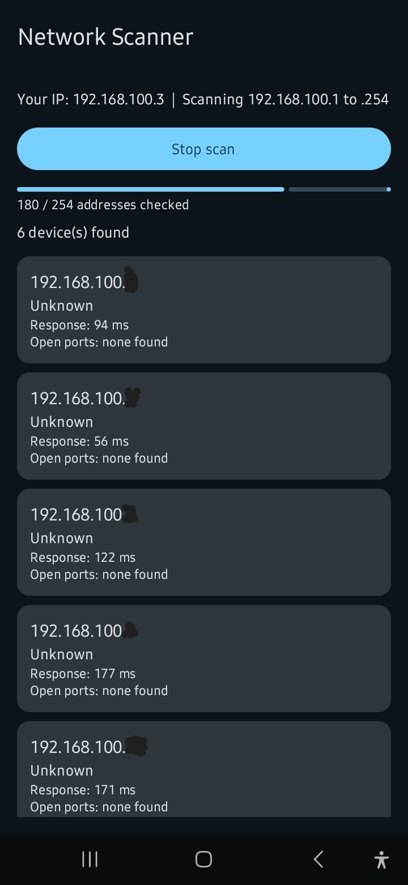
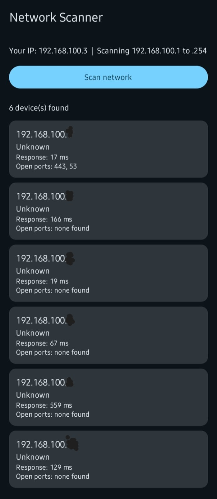

# Network Scanner for Android


An Android app that discovers live devices on your local Wi-Fi network. Tap one button and the app finds your phone's IP address, works out the subnet, and probes all 254 addresses in parallel. Each device that answers is listed live, with its IP address, hostname, response time and open common ports.

Built with Kotlin, Jetpack Compose, MVVM and coroutines as a hands-on project connecting mobile development with networking and security fundamentals.

## Screenshots

| Before scan | Scanning | Results |
|---|---|---|
|  |  |  |

*Captured on a physical Samsung phone over home Wi-Fi. The last part of each device address is blurred for privacy.*

## Features

- **Automatic subnet detection:** reads the phone's active-network IPv4 address and scans its /24 range (x.x.x.1 to x.x.x.254).
- **Fast concurrent scanning:** up to 64 hosts are probed at once with coroutines and a semaphore, so a full scan finishes in seconds.
- **Layered host detection:** a host counts as alive if a port accepts the connection, actively refuses it, or answers a ping.
- **Open-port check:** probes common ports 22, 53, 80, 443, 445 and 8080 on every live host.
- **Hostname lookup:** attempts reverse DNS and shows "Unknown" when the network publishes no name.
- **Response time:** measured from the first answer received from each host.
- **Live UI:** results appear sorted by address as they are found, with a progress bar and a Start/Stop button.

## How it works

1. **Find the network.** `ConnectivityManager` gives the active network's IPv4 address. The first three octets define the subnet to scan.
2. **Probe every address.** For each of the 254 hosts the scanner tries a short TCP connection to each common port (200 ms timeout). A successful connection means the port is open. A "connection refused" reply also proves the host is alive, because a closed port still answers with a reset.
3. **Fall back to ping.** If no port answered, the scanner tries `InetAddress.isReachable` (300 ms) to catch hosts that listen on none of the probed ports.
4. **Enrich live hosts.** A reverse DNS lookup supplies the hostname, and the elapsed time of the first answer becomes the response time.
5. **Stream the results.** Each finished probe updates a `StateFlow`, and Compose redraws the progress bar and device list immediately.

## Architecture

The app uses MVVM. The UI only renders state, the ViewModel owns the scan lifecycle, and all networking lives in one class that knows nothing about the UI.

```
MainActivity (Jetpack Compose UI)
        |  observes StateFlow<ScanUiState>      ^ user actions
        v                                       |
ScannerViewModel (state, start/stop, job control)
        |  calls
        v
NetworkScanner (sockets, ping, DNS, subnet logic)
        |  probes
        v
Local network (x.x.x.1 to x.x.x.254)
```

### Project structure

```
NetworkScanner/
├── app/
│   ├── build.gradle.kts
│   └── src/main/
│       ├── AndroidManifest.xml
│       └── java/com/chogo/networkscanner/
│           ├── MainActivity.kt        # Compose screen and device cards
│           ├── ScannerViewModel.kt    # UI state and scan lifecycle
│           └── NetworkScanner.kt      # All network scanning logic
├── docs/
│   └── screenshots/
├── LICENSE
└── README.md
```

## Tech stack

| Area | Technology |
|---|---|
| Language | Kotlin |
| UI | Jetpack Compose, Material 3 |
| State | ViewModel, StateFlow |
| Concurrency | Kotlin coroutines, Semaphore, AtomicInteger |
| Networking | `java.net` sockets, `InetAddress`, `ConnectivityManager` |
| Build | Gradle (Kotlin DSL), minSdk 26, targetSdk 37 |

## Getting started

### Requirements

- Android Studio (current stable release)
- An Android phone with USB debugging enabled, or an emulator
- A Wi-Fi network you own or have permission to scan

### Build and run

```bash
git clone https://github.com/YOUR_USERNAME/NetworkScanner.git
```

1. Open the `NetworkScanner` folder in Android Studio and let Gradle sync.
2. Connect a **physical phone** to your Wi-Fi (turn mobile data off) and select it as the run target.
3. Click **Run**, then tap **Scan network**.

> **Tip:** an emulator runs on its own virtual network, so it only sees a few virtual hosts. Use a real phone to discover real devices.

### Permissions

The app requests only normal permissions, which Android grants at install with no pop-up: `INTERNET`, `ACCESS_NETWORK_STATE` and `ACCESS_WIFI_STATE`.

## Testing

| Environment | Result |
|---|---|
| Android Studio emulator | Builds and runs; scan completes and lists the emulator's 3 virtual hosts. |
| Physical Samsung phone (SM-A127F), home Wi-Fi | Detects the phone's own IP and subnet, completes the scan, and lists 6 devices. The router is identified by its open ports (443 and 53). All hostnames show "Unknown" because the router does not publish reverse DNS names. |

## Known limitations

- **No MAC addresses.** Android 10 and above stop apps from reading other devices' MAC addresses, so the app reports response time and open ports instead.
- **/24 only.** The scan range is always the last octet of the phone's own subnet.
- **IPv4 only.** IPv6 neighbours are not discovered.
- **Silent devices are missed.** Hosts that drop all traffic to the probed ports and ignore ping will not appear.
- **Limited port list.** Only six common ports are probed; there is no full port scan or service fingerprinting.
- **Hostnames depend on your router.** Many home routers do not answer reverse DNS, so most devices show "Unknown".
- **Own device is listed.** The phone running the scan appears in the results like any other host.

## Responsible use

Only scan networks you own or have explicit permission to test. The app makes short TCP connection attempts and DNS lookups, sends no exploit payloads, stores no data, and keeps results in memory for the current session only.

## Roadmap

- [ ] Label the scanning phone as "This device"
- [ ] Save scan history with Room and highlight new or missing devices
- [ ] Export results to CSV
- [ ] Custom port lists and CIDR input for non-/24 networks
- [ ] Device-type hints based on open ports and hostnames
- [ ] Unit tests for subnet logic and ViewModel state
- [ ] GitHub Actions workflow to build and test the APK on every push
- [ ] Custom app icon

## License

Released under the [MIT License](LICENSE).

## Author

**Iman**, IT student building a portfolio across networking, cybersecurity, cloud/DevOps and software development.
